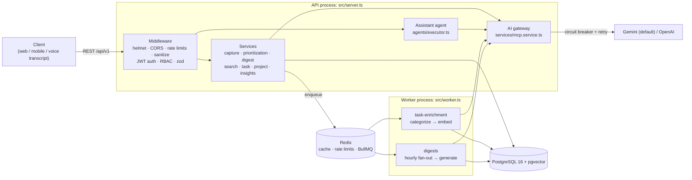
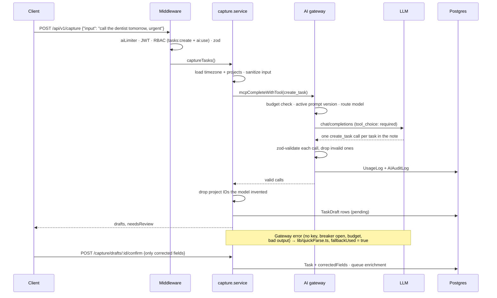
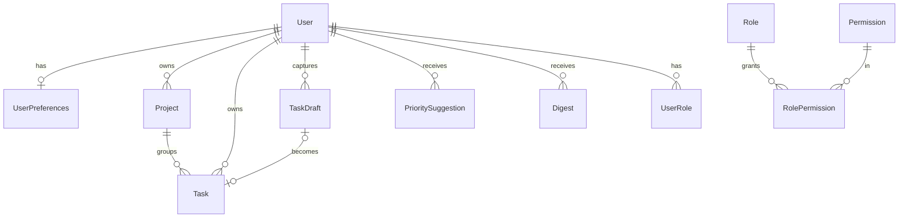

# TaskLume

An AI-assisted task manager backend. The AI acts as an assistant rather than a record-keeper: it turns plain-language notes into structured tasks, files them into projects, suggests what to work on first, and sends daily and weekly briefings. Every AI decision is a suggestion the user can see, correct, or reject.

It is built on the DocuChat architecture: Express 5 + TypeScript, PostgreSQL (Prisma + pgvector), Redis (cache, rate limits, BullMQ), JWT auth with refresh rotation, RBAC, domain events, Prometheus metrics, Swagger, and the same AI gateway, agent executor and circuit-breaker stack.

## Prerequisites

- **Node.js 20+** and npm
- **Docker** with Docker Compose, for Postgres (with pgvector) and Redis. Without Docker, you need PostgreSQL 16 with the [pgvector](https://github.com/pgvector/pgvector) extension and Redis 7, and must point `DATABASE_URL` / `REDIS_URL` at them.
- *Optional:* a [Gemini](https://aistudio.google.com/apikey) or OpenAI API key. Without one, the AI features use their non-AI fallbacks.

## Setup and installation

```bash
# 1. Install dependencies
npm install

# 2. Create your environment file
cp .env.example .env
#    Set JWT_ACCESS_SECRET and JWT_REFRESH_SECRET to two different values:
#      openssl rand -hex 32
#    Optionally set GEMINI_API_KEY (or AI_PROVIDER=openai + OPENAI_API_KEY)

# 3. Start Postgres (pgvector) and Redis
docker compose up -d

# 4. Create the schema and seed roles, permissions and v1 prompts
npx prisma generate
npm run db:deploy
npm run db:seed

# 5. Run the API and the background worker (two terminals)
npm run dev                     # API on http://localhost:3000
npm run dev:worker              # enrichment + digest worker
```

TaskLume runs fine **without an AI key**. Every AI feature then uses its non-AI fallback (see below), and only the assistant returns 503.

| URL | What |
|---|---|
| `http://localhost:3000/api-docs` | Swagger UI (all endpoints, try them in the browser) |
| `http://localhost:3000/health/ready` | DB + Redis readiness |
| `http://localhost:3000/metrics` | Prometheus metrics |
| `http://localhost:3000/admin/queues` | Bull Board (non-production only) |

### Try it

All API routes live under `/api/v1`. Register, log in, then send the access token as a Bearer token:

```bash
curl -X POST localhost:3000/api/v1/auth/register -H 'Content-Type: application/json' \
  -d '{"name":"Ada","email":"ada@example.com","password":"Password123"}'

TOKEN=$(curl -s -X POST localhost:3000/api/v1/auth/login -H 'Content-Type: application/json' \
  -d '{"email":"ada@example.com","password":"Password123"}' | sed -E 's/.*"accessToken":"([^"]+)".*/\1/')

curl -X POST localhost:3000/api/v1/capture -H "Authorization: Bearer $TOKEN" \
  -H 'Content-Type: application/json' -d '{"input":"call the dentist tomorrow, urgent #health"}'
```

New users get the `member` role. To make yourself an admin (for `/api/v1/admin/*` and `insights:read`):

```bash
docker compose exec postgres psql -U tasklume -d tasklume -c \
  "INSERT INTO \"UserRole\" (\"userId\",\"roleId\") SELECT u.id, r.id FROM \"User\" u, \"Role\" r WHERE u.email='ada@example.com' AND r.name='admin';"
```

### Environment variables

Everything is documented in [.env.example](.env.example) and validated at startup by `src/lib/config.ts`, which exits with a clear message if something is missing.

| Variable | Required | Notes |
|---|---|---|
| `DATABASE_URL` | yes | Postgres with pgvector |
| `JWT_ACCESS_SECRET`, `JWT_REFRESH_SECRET` | yes | ≥ 32 characters each, must differ |
| `REDIS_URL` | no | Defaults to `redis://localhost:6379` |
| `AI_PROVIDER`, `GEMINI_API_KEY`, `OPENAI_API_KEY` | no | Leave keys empty to run with AI off |
| `WEBHOOK_SECRET` | no | Webhooks return 503 until set |
| `CAPTURE_AUTO_CONFIRM_MIN_CONFIDENCE`, `CATEGORIZE_MIN_CONFIDENCE`, `DIGESTS_ENABLED`, `AI_AUDIT_LOG_CONTENT` | no | Feature tuning; defaults are in `.env.example` |

### Credentials and security

No real secrets are committed. `.env` is git-ignored and only `.env.example` (placeholders) is tracked. The Postgres password in `docker-compose.yml` and the JWT values in the CI workflow are local/test-only values, not production credentials. Passwords are hashed with bcrypt, refresh tokens are rotated, and AI audit logs redact prompt content unless `AI_AUDIT_LOG_CONTENT=true`.

## Dependencies

Installed by `npm install` from [package.json](package.json) (exact versions are locked in `package-lock.json`).

| Area | Packages |
|---|---|
| Web server | `express` 5, `cors`, `helmet`, `express-rate-limit`, `rate-limit-redis`, `xss` |
| Database | `@prisma/client`, `@prisma/adapter-pg`, `pg` (PostgreSQL + pgvector) |
| Redis & queues | `ioredis`, `bullmq`, `@bull-board/*` |
| Auth | `jsonwebtoken`, `bcryptjs` |
| Validation & config | `zod`, `dotenv` |
| Resilience & HTTP | `axios`, `opossum` (circuit breaker) |
| Observability & docs | `winston`, `prom-client`, `swagger-jsdoc`, `swagger-ui-express` |
| Dev / test | `typescript`, `tsx`, `prisma`, `vitest`, `@vitest/coverage-v8`, `supertest` |

AI providers are called through their OpenAI-compatible HTTP APIs with `axios`, so no provider SDK is needed.

## Features

All endpoints below are relative to `/api/v1`. Full request/response schemas are in Swagger at `/api-docs`.

| Feature | Endpoint | How the AI is used | Without AI |
|---|---|---|---|
| **Natural-language capture** | `POST /capture` | LLM calls a `create_task` tool (once per task in the note) to extract title, due date, priority, project and tags, plus a confidence score and the assumptions it made | Rule-based parser (`lib/quickParse.ts`): today/tomorrow, weekdays, "next week", "in N days", ASAP/someday, #tags |
| **Review before saving** | `GET /capture/drafts`, `POST /capture/drafts/:id/confirm`, `DELETE /capture/drafts/:id` | Captures become **drafts**. Confirm as-is or send only the fields to correct. Confident parses can skip review if the user enables `autoConfirmCapture` | Rules-parser drafts are always reviewed |
| **Auto-categorization** | (background) | Tasks created without a project are filed by the worker (`assign_project` tool), only above `CATEGORIZE_MIN_CONFIDENCE`. Marked `projectSetBy: "ai"` | Task stays unfiled |
| **Smart prioritization** | `POST /priorities/suggestions`, `…/:id/accept`, `…/:id/dismiss` | Fixed-formula urgency score (deadline, priority, age, project weights), then the LLM re-ranks against the user's goals with a reason per task. **Never applied automatically.** Accept all or only some | The formula's ranking, with its factors as reasons |
| **Proactive digests** | `POST /digests`, `GET /digests/latest`, `GET /digests` | Hourly scheduler generates daily/weekly digests at each user's local `digestHour`. Counts come from the DB; the LLM only writes the prose | Templated summary from the same stats |
| **Semantic search** | `GET /tasks/search?q=` | Tasks are embedded (pgvector) and searched by meaning | Keyword search (`meta.mode` says which ran) |
| **Assistant** | `POST /assistant` | Tool-calling agent: `search_tasks`, `get_overdue_tasks`, `get_upcoming_tasks`, `summarize_tasks`, `list_projects`, `create_task` (makes a draft), `final_answer` | 503 |
| Manual tasks & projects | `/tasks`, `/projects` | None needed. Full CRUD with filters (`status=open`, `overdue`, `dueBefore`, `tag`, …) | Always available |
| Preferences | `GET/PATCH /me/preferences` | Timezone, stated goals, per-project weights (0.5–2), digest schedule, auto-confirm | — |
| Success metrics | `GET /me/insights`, `GET /admin/insights` | Parse accuracy, on-time completion, suggestion acceptance, fallback rates, AI spend | — |

Voice input is a client concern: send the speech-to-text transcript to `POST /capture`.

### Dates and timezones

Users have an IANA timezone. Due dates can be sent as an absolute ISO timestamp or as local `YYYY-MM-DD` / `YYYY-MM-DDTHH:mm`, and a bare date means the end of that local day. The AI is given the user's current local date and returns local dates. The server converts them (DST-safe, `lib/dates.ts`), so "tomorrow" is the user's tomorrow, not the server's.

## System architecture

TaskLume is backend-only. It runs as two processes, an HTTP API and a queue worker, that share PostgreSQL and Redis. Slow AI jobs therefore never hold up HTTP requests.



### Request lifecycle: natural-language capture



## AI architecture

```
route → service ─┬─ mcpComplete / mcpCompleteWithTool  (services/mcp.service.ts — the AI gateway)
                 │    no key? → AIUnavailableError (caller falls back)
                 │    budget check (monthly per tier, Redis counter rebuilt from UsageLog)
                 │    prompt: active PromptTemplate row → else config/prompts.ts constant
                 │    model routing per task type (config/ai-models.ts)
                 │    fallback model chain → aiBreaker (circuit breaker + retry)
                 │    zod-validate every tool call; invalid ones are dropped
                 │    cost tracking → UsageLog, AIAuditLog (excerpts redacted unless AI_AUDIT_LOG_CONTENT=true)
                 └─ catch → non-AI fallback, aiFallbacks{feature} metric, fallbackUsed=true on the record
```

- **Structured output** uses forced tool calls (`tool_choice: "required"`) validated with zod, not free-text JSON. Hallucinated IDs (projects, tasks) are dropped.
- **Provenance**: `Task.source`, `prioritySetBy` and `projectSetBy` record whether the user or the AI made each decision. A user edit always wins and flips it back to `user`. Accepting a suggestion skips tasks whose priority the user changed after it was made.
- **Prompt injection**: user and task text is run through `lib/promptSanitizer.ts`, wrapped in delimiters, and every prompt states that it is data, not instructions.
- **Prompt versioning**: `npm run db:seed` stores v1 of each prompt. Ship v2 by inserting a row with `isActive=true`; the gateway picks it up within 5 minutes.
- **Providers**: Gemini (default) and OpenAI share the OpenAI-compatible API, so `AI_PROVIDER` swaps them with no code changes.

### AI components

| Component | Model (Gemini / OpenAI) | Input the model sees | Output, and how it is checked | Fallback |
|---|---|---|---|---|
| Capture (`services/capture.service.ts`) | `gemini-3.5-flash-lite` / `gpt-4o-mini` | Current local date and tomorrow's date, the user's projects (id, name, description), and the note between `<<<` and `>>>` | Forced `create_task` calls (≤ 5 per note): title, dueDate, priority, projectId, tags, confidence, ambiguities. zod-validated; unknown project IDs nulled | `lib/quickParse.ts` regex rules |
| Categorize (`services/categorize.service.ts`) | flash-lite / 4o-mini | One task and the user's projects | Forced `assign_project` {projectId, confidence, reason}; applied only if confidence ≥ `CATEGORIZE_MIN_CONFIDENCE` (0.7) | Task stays unfiled |
| Prioritize (`services/prioritization.service.ts`) | `gemini-3.5-flash` / `gpt-4o` | Current time, the user's goals, and the top 40 open tasks with their heuristic score and `prioritySetBy` | Forced `submit_ranking`; `mergeRanking()` drops unknown or duplicate IDs and appends any skipped tasks in heuristic order | `lib/priorityScore.ts` ranking, with its factors as reasons |
| Digest (`services/digest.service.ts`) | flash-lite / 4o-mini | Stats and task snapshots computed in SQL | 3–6 sentences of prose; the prompt forbids inventing counts | `templateSummary()` |
| Search (`services/search.service.ts`) | `gemini-embedding-001` / `text-embedding-3-small`, 1536 dimensions | Title, description, tags and project name; the query | pgvector cosine similarity scoped to the user; hits below 0.35 are dropped; query embeddings cached by content hash | SQL keyword search |
| Assistant (`agents/executor.ts`) | flash / 4o | Question and current time; tool results | Tool-calling loop. Tools are looked up in a registry and args zod-validated; `userId` comes from the session, never from the model. Limits: 6 iterations, 60 s, $0.25 | 503 |

The heuristic score (`lib/priorityScore.ts`) is deterministic and explains itself. It combines priority points (urgent 40, high 25, medium 12, low 4) with due-date pressure (overdue +50 plus up to 20 more, within 24 h +40, within 3 days +25, within a week +12), +5 for in-progress tasks, and an age bonus after 14 days so old low-priority work isn't starved. The total is multiplied by the user's project weight (0.5–2). The LLM starts from this score, so its ranking stays anchored even when it adds judgment.

### Background work

| Queue | Job | Notes |
|---|---|---|
| `task-enrichment` | Categorize (if unfiled) then embed | Queued on create and on title/description/project edits. Status on `Task.enrichmentStatus`; `skipped` when AI is off. DLQ after 3 attempts |
| `digests` | Hourly fan-out → per-user `generate` jobs | jobId `digest-{user}-{period}-{key}` plus a unique DB constraint make it idempotent. Also expires drafts older than 7 days |

All queues use the `tasklume` BullMQ prefix so TaskLume can share a Redis with DocuChat.

No vector index is created on `Task.embedding`: search is always scoped to one user's tasks (filtered by the `userId` index first), which stays small. DocuChat's hand-written HNSW index was dropped by a later `prisma migrate dev`, because Prisma can't model it. If you add one, do it in a migration and expect to re-add it.

## Data model

Full schema: [prisma/schema.prisma](prisma/schema.prisma).



| Model | Purpose |
|---|---|
| `Task` | The task, plus provenance (`source`, `prioritySetBy`, `projectSetBy`), `enrichmentStatus`, and a `vector(1536)` embedding |
| `TaskDraft` | The AI's reading of a capture, held for review. `parsed` vs. `correctedFields` measures parse accuracy |
| `PrioritySuggestion` | A ranked recommendation with a reason per task: pending → accepted / partially_accepted / dismissed |
| `Digest` | Daily or weekly briefing; unique on `(userId, period, periodKey)` |
| `UserPreferences` | Timezone, goals, project weights, digest schedule, auto-confirm |
| `PromptTemplate` | Versioned system prompts |
| `AIAuditLog`, `UsageLog` | Model, tokens, cost, latency and fallback flag per call; usage events |
| `Role`, `Permission`, `UserRole`, `RolePermission`, `RefreshToken` | RBAC and auth |

## Reliability and security

| Concern | How it is handled |
|---|---|
| AI provider down or no key | Every feature catches gateway errors and falls back; `fallbackUsed` is stored and counted in `tasklume_ai_fallbacks_total` |
| Flaky provider | `opossum` circuit breaker with retries (`lib/http/*.breaker.ts`) plus a per-model fallback chain |
| Runaway cost | Monthly budget per tier (free $1, pro $20, enterprise $200) checked before every call, kept in Redis and rebuilt from `UsageLog`; per-run ceiling on the agent |
| Wrong AI output | Forced tool calls validated with zod, invented IDs dropped, captures held as drafts, suggestions never auto-applied, user edits always win |
| Duplicate actions | Drafts and suggestions are claimed with a conditional `updateMany(status: 'pending')`; jobs are idempotent |
| Auth | JWT access tokens (15 min), rotated refresh tokens stored as SHA-256 hashes, bcrypt passwords |
| Authorization | RBAC on every route; other users' resources return 404 |
| Input | zod on every route, XSS sanitizing, 1 MB body limit, `helmet`, Redis-backed rate limits (stricter `aiLimiter` on AI routes), abuse detection |
| Prompt injection | `lib/promptSanitizer.ts`, delimited user text, "data, not instructions" in every prompt |
| Privacy | AI audit excerpts are `[redacted]` unless `AI_AUDIT_LOG_CONTENT=true` |
| Observability | winston JSON logs with correlation IDs, Prometheus `/metrics`, `/health/live` and `/health/ready` |

## API reference

Base path `/api/v1`. Send `Authorization: Bearer <accessToken>` on every route except `/auth/*`. Full request and response schemas are in Swagger at `/api-docs`.

| Area | Endpoints |
|---|---|
| Auth | `POST /auth/register` · `POST /auth/login` · `POST /auth/refresh` (rotates) · `POST /auth/logout` |
| Tasks | `GET /tasks` (filters: `status`, `overdue`, `projectId`, `priority`, `tag`, `dueBefore`, `dueAfter`, `search`) · `POST /tasks` · `GET/PATCH/DELETE /tasks/:id` · `GET /tasks/search?q=` |
| Projects | `GET /projects` · `POST /projects` · `PATCH/DELETE /projects/:id` |
| Capture | `POST /capture` `{input, autoConfirm?}` · `GET /capture/drafts` · `POST /capture/drafts/:id/confirm` `{fields to correct}` · `DELETE /capture/drafts/:id` |
| Prioritization | `POST /priorities/suggestions` `{projectId?}` · `GET /priorities/suggestions[/:id]` · `POST …/:id/accept` `{taskIds?}` · `POST …/:id/dismiss` |
| Digests | `POST /digests` `{period}` · `GET /digests/latest?period=` · `GET /digests` |
| Assistant | `POST /assistant` `{message}` → `answer, taskIds, draftIds, confidence, iterations, totalCostUsd, terminationReason, trace` |
| Me | `GET/PATCH /me/preferences` · `GET /me/insights?days=30` |
| Admin | `GET /admin/roles` · `POST /admin/users/:userId/roles` · `DELETE /admin/users/:userId/roles/:roleName` · `GET /admin/insights` |

Example `POST /capture` result:

```json
{
  "success": true,
  "data": {
    "fallbackUsed": false,
    "needsReview": true,
    "results": [{
      "draft": {
        "rawInput": "follow up with the vendor sometime next week",
        "parsed": { "title": "Follow up with the vendor", "dueDate": "2026-11-15",
                    "priority": "medium", "projectId": null, "tags": ["vendor"] },
        "confidence": 0.72,
        "ambiguities": ["'Sometime next week' was read as the last day of next week."],
        "status": "pending"
      },
      "task": null
    }]
  }
}
```

## Measuring success

`GET /me/insights?days=30` (own data) and `GET /admin/insights` (all users, `insights:read`):

| Brief KPI | Field | Source |
|---|---|---|
| Accuracy of AI parsing | `capture.parseAccuracy` (+ `mostCorrectedFields`) | Drafts confirmed with no corrected fields |
| Task completion on time | `completion.onTimeRate` | `completedAt <= dueDate` |
| Trust in suggestions | `prioritization.acceptanceRate` | Accepted or partly accepted ÷ resolved |
| AI availability | `capture.rulesFallbackDrafts`, `digests.fallbackRate`, `prioritization.fallbackSuggestions` | `fallbackUsed` flags |
| Cost | `ai.costUsd`, `ai.tokens` | UsageLog |

Prometheus has the same signals as counters: `tasklume_capture_drafts_resolved_total{status,corrected,source}`, `tasklume_priority_suggestions_resolved_total`, `tasklume_ai_fallbacks_total{feature}`, `tasklume_ai_calls_total{task_type,outcome}`, `tasklume_digests_generated_total`, plus agent iteration/cost histograms. Retention and time saved need product analytics or surveys; the `UsageLog` actions (`task_created`, `draft_confirmed`, `suggestion_accepted`, `digest_generated`, …) are the raw events for that.

## Layout

```
src/
├── server.ts / worker.ts   Entry points: HTTP API and queue worker (separate processes)
├── app.ts                  Middleware order, route mounting, error handler
├── agents/                 Assistant: executor (think → act → observe loop, limits) + tools/
├── config/                 ai-models (provider/model routing), prompts, feature config, Swagger, Bull Board
├── jobs/                   digest-fan-out (scheduled)
├── lib/                    config, logger, prisma, cache, errors, events, metrics, tokens,
│   │                       dates (timezones), quickParse (fallback parser), priorityScore
│   └── http/               gemini/openai clients → retry → circuit breaker → ai.breaker
├── middleware/             authenticate, authorize (RBAC), validate (zod), sanitize, rate limits
│                           (incl. aiLimiter), ETag, logging, metrics, webhooks, abuse detection
├── routes/                 task, project, ai (capture/priorities/digests/assistant), me, admin, auth
├── controllers/            HTTP in/out only
├── services/               mcp (AI gateway), capture, categorize, prioritization, digest, search,
│                           embedding, task, project, preferences, insights, rbac, auth
├── repositories/           Prisma queries (task incl. pgvector SQL, project, user)
├── validators/             zod schemas
├── events/                 task / ai / cache / auth / admin / security listeners
└── queues/                 task-enrichment, digests, dead-letter
```

### Roles

| Role | Permissions |
|---|---|
| `member` (default) | `tasks:*`, `projects:*`, `ai:use` |
| `viewer` | `tasks:read`, `projects:read` (no AI spend) |
| `admin` | everything, incl. `tasks:manage`, `insights:read`, `roles:manage` |

## Conventions

- **Responses**: `{ success: true, data, meta? }` or `{ success: false, error: { code, message, details? } }`.
- **Errors**: throw `AppError` subclasses from `lib/errors.ts`. Express 5 forwards async errors.
- **Ownership**: 404, not 403, for other users' resources.
- **Soft delete**: `deletedAt` / `deletedBy`; deleting a project unassigns its tasks.
- **AI never blocks the core path**: creating, editing and listing tasks never waits on the model.
- **Jobs are idempotent**: BullMQ retries them. Mark failed only on the last attempt.
- **Correlation IDs** flow from `X-Correlation-Id` through logs, AI audit rows and job data.

## Tests

`npm test` runs unit tests with **no database, Redis or AI provider**. The AI breaker and gateway are mocked. Covered: timezone math (incl. DST), the fallback parser, priority scoring, gateway tool-call validation/redaction/budget, capture parsing and correction diffing, ranking merge, template digests, and the agent loop (tool calls, bad calls, iteration and cost limits).

| Script | Does |
|---|---|
| `npm run dev` / `dev:worker` | Watch-mode API / worker |
| `npm run build` / `start` / `start:worker` | Compile to `dist/` and run |
| `npm run typecheck` | `tsc --noEmit` over src, prisma, tests |
| `npm test` / `test:coverage` | Vitest |
| `npm run db:migrate` / `db:deploy` / `db:seed` | Prisma |
